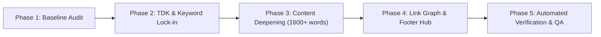

# Gefei Page Optimizer (哥飞 On-Page SEO 黄金法则实战技能)

This skill encapsulates the battle-tested, repeatable methodology for taking web pages to **98+ points** in **Gefei Page Coach (页面军师)**, eliminating thin pages, locking in high-value search intent, and building robust, crawl-efficient internal link graphs.

---

## When to Use This Skill

Activate this skill whenever you need to:
- **Audit existing web pages** for SEO deficiencies, low word count, missing keyword claims, or broken PageRank flow.
- **Optimize or write new content** to guarantee 98+ On-Page SEO health scores.
- **Eliminate orphan pages (孤岛页面)** and flatten site crawl depth to $\le 2$.
- **Resolve single-item topic dead ends (死胡同)** and optimize internal recommendation algorithms.
- **Align Title, H1, Meta Description, and URL slugs** with exact user search intents.

---

## 5-Phase Optimization Workflow



---

### Phase 1: Baseline Audit & Keyword Lock-in (基线体检与核心词锁定)

1. **Run Gefei Page Coach (页面军师)**:
   - Use the `gefei-seo:page_coach` MCP tool on the target URL.
   - Extract:
     - Automatically inferred keywords (`inferredKeywords`).
     - Is the primary keyword claimed (`claimed: true`)?
     - Deductions list: Check if H1 (-8 pts), Title (-2 pts), Description (-1 pt), URL (-0.5 pt), or density (-4 pts) were triggered.
     - Thin page indicator: Is word count below 1,600 words?
2. **Lock-in the Single Core Intent**:
   - Every page must win **one core keyword**. Multi-intent blending dilutes density and triggers the "赛道错位" warning.
   - Verify SERP platform mix: If Top 10 results are predominantly platforms (YouTube, Wikipedia), focus on niche high-intent informational modifiers (`[topic] lecture notes`, `[concept] derivations`, `[name] study notes`).

---

### Phase 2: TDK Hardening & Deductions Elimination (TDK 极简满分公式)

Eliminate the 4 structural point-drop pitfalls:

1. **Title Formula (45 ~ 60 Chars)**:
   - `[Core Keyword] — [Entity/Speaker]: [Subtitle] | [Brand]`
   - *Example*: `Simple Made Easy — Rich Hickey: Lecture Notes | HackerTube`
   - ⚠️ **Next.js App Router Trap**: If your root layout defines `title: { template: "%s | Brand", default: "Brand" }`, inner pages must use `title: { absolute: pageTitle }` to prevent double-branding and exceeding the 60-character truncation ceiling.
2. **H1 Title Formula (Must Match 100% of Target Tokens)**:
   - The H1 must contain **100% of the target keyword tokens** to avoid the **-8 point deduction**.
   - *Example*: Target keyword `simple made easy` $\rightarrow$ `<h1>Simple Made Easy — Rich Hickey</h1>`.
3. **Meta Description (140 ~ 160 Chars)**:
   - Embed the target keyword in the **first 80 characters**.
   - Include clear actionability, audience appeal, and unique value proposition.
4. **URL Slug & Search Aliases**:
   - If the canonical URL has a legacy ID (`/v/carmack-quake-graphics`), create a keyword-rich alias route (`/v/fast-inverse-square-root`) via `ALIAS_MAP` in your router.

---

### Phase 3: Content Deepening & Anti-Thin Architecture (反薄内容 6 大高价值模块)

To eliminate thin content penalties and dominate the 1~5 keyword density leaderboards (+8/8 points), structure content using the 6-module blueprint (see [templates/study_note_template.ts](./templates/study_note_template.ts)):

1. **Executive Synthesis & Mental Models (150 words)**: High-density conceptual definitions.
2. **Timestamped Chronological Breakdown (400 words)**: Key timestamps, deep explanations, and concrete takeaways.
3. **Architecture Diffs & Code Snippets (300 words)**: Anti-pattern vs recommended pattern code, ASCII diagrams, or KaTeX mathematical derivations.
4. **Community Consensus & HN Debates (300 words)**: Structured trade-offs, quotes from practitioners, and counter-arguments.
5. **Schema.org FAQPage (400 words)**: 5+ granular questions directly answering Google's "People Also Ask" (PAA) queries. Natural repetitions of the target keyword here solidify density without keyword stuffing.
6. **Actionable Playground / Interactive Links (50 words)**.

> **Target Threshold**: Total body word count must reach **1,600 ~ 2,000+ English words** (or 2,500+ Chinese characters).

---

### Phase 4: Gefei Link Graph & Footer Hub (内链图谱六大军规)

Build a self-reinforcing link graph that delivers PageRank to every page:

1. **Zero Orphan Pages (零孤岛)**:
   - Every page must have $\ge 3$ incoming internal links.
   - All search alias routes must be linked globally via the Universal Footer and included in `sitemap.xml`.
2. **Crawl Depth $\le 2$ (抓取深度扁平化)**:
   - All content pages and topic hubs must be reachable from the homepage in 1 to 2 hops (BFS shortest path).
3. **Eliminate Dead Ends in Single-Item Categories (根治单视频死胡同)**:
   - When a category has only 1 or 2 items, never render 0 related items.
   - **Remediation Pattern**:
     ```typescript
     const sameTopic = ALL_ITEMS.filter((v) => v.topic === item.topic && v.id !== item.id);
     const crossTopic = ALL_ITEMS.filter((v) => v.topic !== item.topic && v.id !== item.id)
       .sort((a, b) => b.popularity - a.popularity);
     const relatedItems = [...sameTopic, ...crossTopic].slice(0, 3);
     const heading = sameTopic.length > 0
       ? `More High-Signal ${item.topic} Content`
       : `More High-Signal Recommended Content`;
     ```
4. **Universal Footer Navigation (全站统一权威底栏)**:
   - Mount `<Footer />` identically on Home, Hubs, and Detail pages.
   - Include: Curated Categories, Featured Guides (alias links), Sitemap.xml, Robots.txt, and Dataset downloads.
5. **Bidirectional Bridge Links**:
   - Between canonical (`/v/carmack-quake-graphics`) and alias (`/v/fast-inverse-square-root`), render explicit in-body link badges (`Canonical: ...` and `Guide: ...`).
6. **Descriptive Anchor Texts**:
   - Zero empty `<a>` tags.
   - Zero generic anchor strings (`click here`, `read more`, `link`). All anchors must reflect full titles or technical entities.

---

### Phase 5: Automated Verification & Production QA

Run the bundled audit suite before deploying to production:

```bash
# 1. Audit internal link graph of static build
python3 .agents/skills/gefei-page-optimizer/scripts/audit_internal_links.py \
  --dir .next/server/app \
  --domain https://www.hacker-tube.net \
  --min-out 5

# 2. Check sitemap accessibility (must be 100% 200 OK)
curl -s https://www.hacker-tube.net/sitemap.xml | grep -o 'https://[^<]*' | xargs -I {} curl -s -o /dev/null -w "%{http_code} {}\n" {}

# 3. Verify Page Coach score via MCP
# Expected: Score >= 94-98+, Claimed = True, Focus >= 95%
```

---

## Detailed References & Tools

- [Gefei Scoring Rubric & Deductions Matrix](./references/gefei_scoring_rubric.md): In-depth table of penalties, TDK length limits, and algorithm mechanics.
- [Internal Link Graph Auditor Script](./scripts/audit_internal_links.py): Reusable CLI auditor for orphan pages, BFS depth, and anchor text.
- [High-Signal Study Note Content Template](./templates/study_note_template.ts): TypeScript interface and reference data model for 98+ scores.
